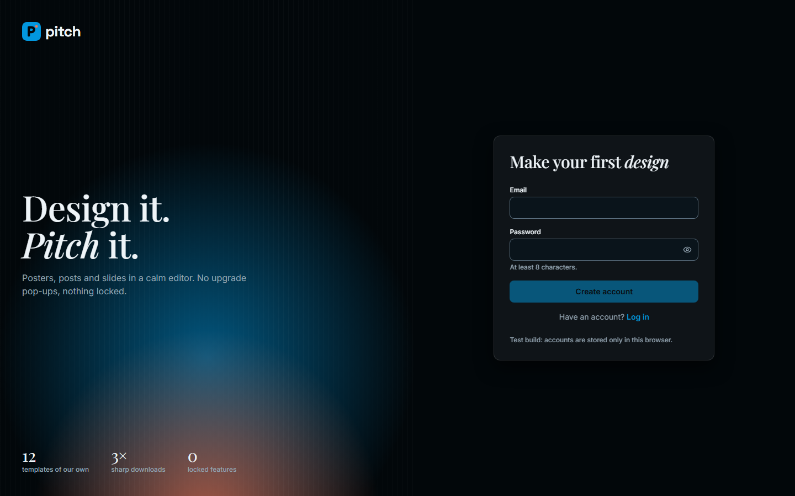
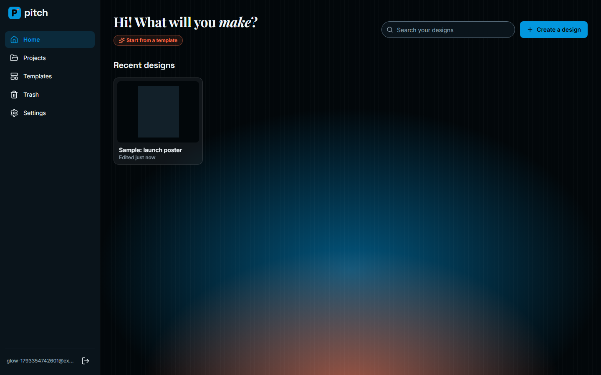
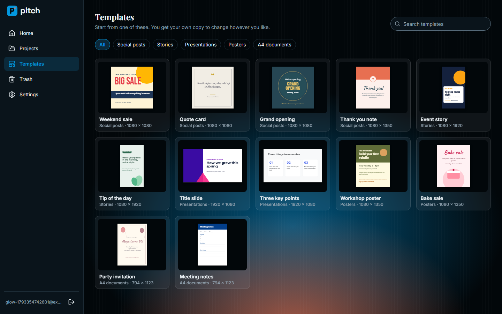
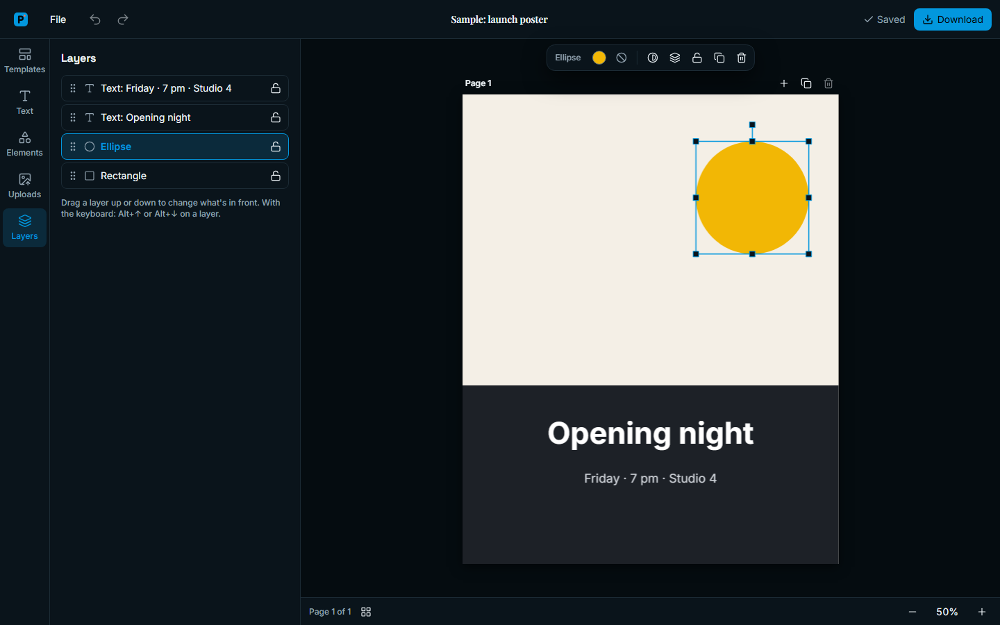
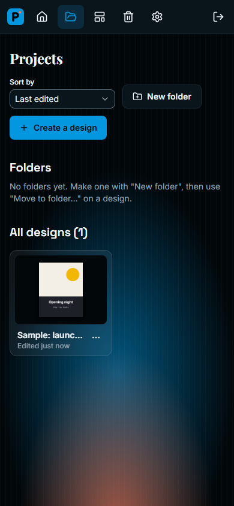

<p align="center">
  
</p>

<h1 align="center">Pitch</h1>

<p align="center">
  <b>Design it. <i>Pitch</i> it.</b><br>
  A Canva-style design editor, built from scratch with Claude Code, to learn how one works.
</p>

<p align="center">
  React · Konva · FastAPI · Supabase · 92 API tests · 76 browser tests
</p>

## Screenshots

The "Glow" look: midnight black, electric blue and a spark of orange. Shown with made-up data.

<table>
  <tr>
    <td></td>
    <td></td>
  </tr>
  <tr>
    <td align="center"><b>Log in</b></td>
    <td align="center"><b>Home</b></td>
  </tr>
  <tr>
    <td></td>
    <td></td>
  </tr>
  <tr>
    <td align="center"><b>Templates</b></td>
    <td align="center"><b>Editor</b></td>
  </tr>
</table>

<p align="center">
  <br>
  <b>On a phone</b>
</p>

## What you can do

- **Start anywhere:** pick a size preset, type your own size (px, in, mm or cm), or start from one of
  12 templates made for this project: social posts, stories, slides, posters and A4 pages.
- **Add things:** headings and text, rectangles, ellipses, triangles, lines and arrows, and your own photos.
- **Edit on the page:** type straight onto the canvas; 9 open-licence fonts, colours, bold / italic /
  underline, alignment, spacing, shadow and outline.
- **Arrange:** move, resize and rotate with snapping guides; align, flip, lock, group; exact X, Y, width,
  height and rotation; a Layers list you can drag to reorder.
- **Photos:** upload PNG, JPG or WebP, place them and crop them.
- **Pages:** several pages per design, with a grid view to reorder them.
- **Work fast:** undo / redo, copy and paste (even between designs), a right-click menu, zoom, keyboard
  shortcuts, and a keyboard-only way to select and move things.
- **Never lose work:** autosave with its status shown, and a warning if another tab saved first.
- **Download:** PNG or JPG at 1×, 2× or 3×, or a PDF of all or chosen pages.
- **Stay organised:** search, folders, "Make a copy", and a Trash you can restore from.
- **Your account:** sign up, log in, reset a forgotten password by email, change it in Settings.

## Run it

**Easiest (Windows):** double-click **`Start Pitch.bat`** in this folder. It builds the website, starts the
server and opens http://localhost:8000. Close its window to stop Pitch. This uses your Supabase project, set
up as in [HOW-TO-RUN.md](HOW-TO-RUN.md).

**Try it without any account:** with no Supabase settings, Pitch keeps everything in your browser.

```
cd frontend
npm install
npm run dev          # http://localhost:5173
```

**Run the tests:**

```
cd backend
uv sync
uv run pytest        # 92 API tests, on a throwaway local Postgres

cd frontend
npx playwright install chromium   # the first time only
npm run e2e          # 76 browser tests, about 5 minutes; never touch Supabase
```

Everything else, such as your own Supabase project, the database setup and fixes for common errors, is in
**[HOW-TO-RUN.md](HOW-TO-RUN.md)**.

## How it's built

| part | tech |
| --- | --- |
| editor and screens | React 19 + TypeScript, Vite, Konva (canvas), Zustand (state and undo), Tailwind CSS v4 with design tokens, Radix UI, Lucide icons, pdf-lib |
| fonts | 9 open-licence fonts served by the app itself (no requests to Google) |
| API | FastAPI (Python 3.12, uv), Pydantic, psycopg 3 with plain SQL |
| database, logins, files | Supabase: Postgres, Auth, and a private Storage bucket with short-lived links |
| tests | pytest with a throwaway Postgres; Playwright with an axe accessibility scan of every screen |

A few choices worth knowing:

- **One data layer, two versions.** Every screen talks to `frontend/src/data/api.ts`. `fake.ts` keeps data in
  the browser and `http.ts` talks to the real server, so the app and its browser tests run without any account.
- **The server checks every design.** The editor saves each design as one JSON document, and
  `backend/app/document.py` refuses anything it doesn't know.
- **Few trips to the database.** The database is far away (about 280 ms per trip from India), so reads skip
  transactions and the login check is a single query. One read went from 1.65 s to 0.55 s.
- **Safe by default.** Every query is limited to your own rows (tested with a second user on every route),
  row-level security is on as a backstop, uploads are checked, requests are rate-limited, and no secret key
  reaches the browser.

## In numbers

- **30 of 30** must-have and **14 of 14** should-have features built (`replica/features.csv`)
- **94.9 / 100** feature parity with the original's core editor
- **21 bugs** found and written up in `replica/bugs.md`, all fixed
- **92 API tests** and **76 browser tests**, all passing

## Where things are

```
Start Pitch.bat        double-click to run Pitch
frontend/              the React app: pages, the editor, the data layers, templates, browser tests (e2e/)
backend/               the FastAPI server (app/) and its tests (tests/)
supabase/migrations/   the database tables
replica/               the plan and reports: recon, architecture, design, brand, features, tests, bugs, build log
HOW-TO-RUN.md          how to run it, test it and fix common errors
```

## A learning project

Pitch runs on my own computer and isn't deployed or published. It isn't affiliated with Canva, or with the
presentation app also called Pitch. It was planned from public sources only (help pages, store listings,
public reviews) and contains none of Canva's code, logos, icons, fonts, templates or copy.
