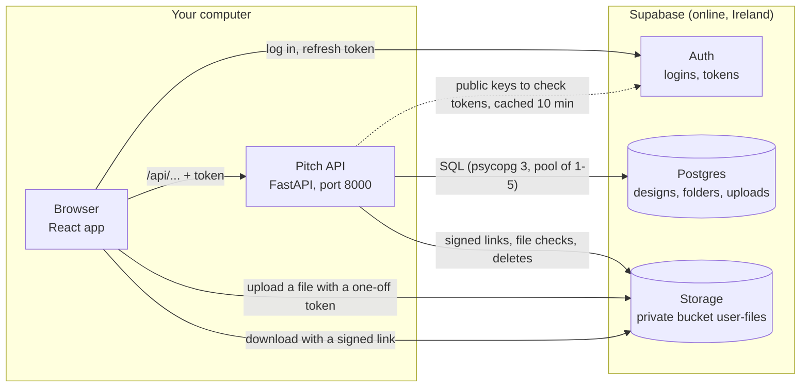
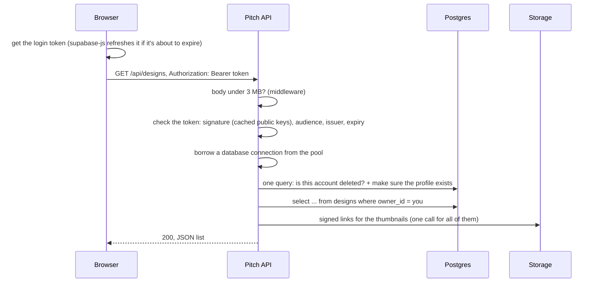
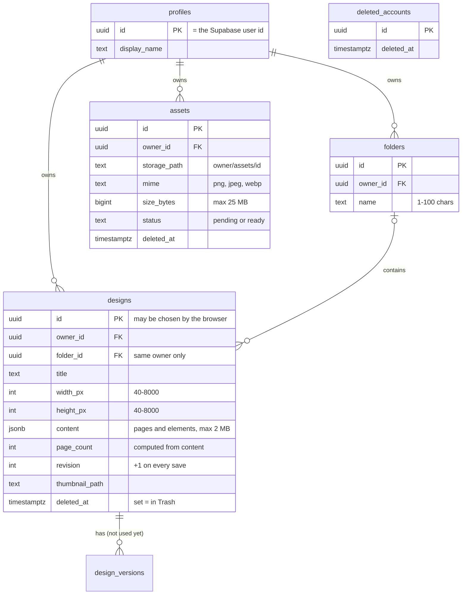
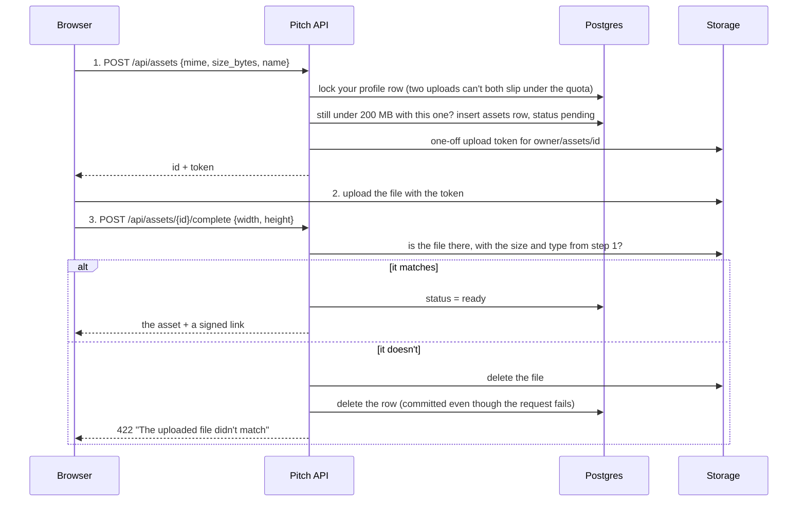

# Pitch: backend system design

How Pitch's server side works: which part does what, what happens on every request, how the data is stored,
and the main flows (saving, uploading photos, thumbnails, Trash). It describes the code as it is on `main`
(2026-11). The diagrams are [Mermaid](https://mermaid.js.org/); GitHub draws them.

Short words used below:

- **API**: Pitch's own server (FastAPI, Python). The browser talks to it at `/api/...`.
- **Token (JWT)**: a signed "this is user X" note that Supabase gives the browser at login. The browser sends it
  with every request; the API checks the signature instead of asking Supabase each time.
- **Transaction**: a group of database changes that happen all together or not at all.
- **Signed link**: a web address for one private file that works only for a short time (1 hour here).

## 1. The big picture



| part | its job | never does |
| --- | --- | --- |
| Browser (React) | the editor; renders pages, keeps the undo history, autosaves the design as JSON, makes thumbnails | sees the secret key or another user's data |
| Supabase Auth | sign up, log in, password reset emails, issues and refreshes tokens | store designs |
| Pitch API | checks every token and every input, runs all database queries, hands out signed links | store files itself |
| Postgres | the rows: profiles, folders, designs (with their content), uploads | get called by the browser directly |
| Storage | the files: uploaded photos and thumbnails | serve a file without a signed link |

Two ways to run it ([HOW-TO-RUN.md](HOW-TO-RUN.md)):

- **While coding:** Vite serves the React app on port 5173 and forwards every `/api` request to the API on
  8000 (`frontend/vite.config.ts`). Same address for both, so no CORS setup is needed.
- **Just using it** (`Start Pitch.bat`): the API also serves the built React files from `frontend/dist`. Any
  path that isn't `/api/...` or a real file gets `index.html`, so links like `/design/123/edit` work.

## 2. The life of one request

Example: Home asks for your designs, `GET /api/designs`.



Step by step, with the file that does it:

1. **Size check** (`main.py`): anything over 3 MB is refused with 413 before it is read.
2. **Login check** (`auth.py`): the token must be signed by the Supabase project (ES256 or RS256, public keys
   fetched from its JWKS address and cached for 10 minutes), meant for `authenticated` users, from the right
   issuer and not expired. Anonymous tokens are refused. Any failure is 401 "Please log in again."
3. **Connection** (`db.py`): each request borrows one connection from a pool of 1 to 5 (the Supabase free plan
   allows only a few). A connection that has been idle for over 30 seconds is tested first, because Supabase
   closes idle connections (BUG-005).
4. **Account check** (`auth.py`): one SQL statement both refuses a deleted account (its tokens stay validly
   signed for up to an hour, BUG-003) and creates the `profiles` row on your first request.
5. **The route** (`routes/*.py`): plain SQL, and **every query has `owner_id = you`**. A design that isn't yours
   answers exactly like a missing one (404), so ids can't be probed.
6. **Commit**: a write request (POST, PUT, PATCH, DELETE) is one transaction, committed *before* the answer is
   sent, so the browser's next request always sees it. A read (GET) skips the transaction (see section 7).

What can come back, and why:

| status | meaning | example |
| --- | --- | --- |
| 401 | not logged in, token expired, or account deleted | a tab left open for a day |
| 404 | missing, or not yours | someone else's design id |
| 409 | conflict | saved from another tab since this edit started |
| 413 | request too big | over 3 MB |
| 422 | input not allowed (says where and why, never echoes the input) | width 9000 px, a SVG upload |
| 429 | too many requests | over 60 upload starts a minute |
| 503 | the login service can't be reached | no internet when the keys need refreshing |

## 3. The data



The tables are in `supabase/migrations/` and are applied once each, in order, by `python -m app.migrate` (it
records what ran in `schema_migrations`).

Choices worth knowing:

- **A whole design is one JSON document** (`designs.content`): pages, each with a background colour and a list of
  elements (text, shapes, lines, photos, groups). The editor saves the whole thing; there is no table per element.
  That keeps saving to one simple query, and undo stays in the browser.
- **The server checks every saved document** (`document.py`, Pydantic with `extra="forbid"`). It mirrors the
  editor's `frontend/src/lib/document.ts`. Unknown fields, NaN, too many elements (1,000 a page, 5,000 in all),
  groups nested over 8 deep, or a broken colour are refused. A new element type or field therefore goes into the
  server first.
- **The database has its own rules too** (check constraints): sizes, 1 to 200 pages, content at most 2 MB, a
  design can only be in a folder with the same owner. Deleting a folder moves its designs back to Projects
  (`on delete set null`), and deleting a profile deletes everything it owns (`on delete cascade`).
- **Indexes match the screens:** recent designs per owner, designs per folder, the Trash, uploads per owner.
- **Not used yet:** `templates` (the 12 templates are files in the app instead, checked by a backend test) and
  `design_versions` (planned version history).

## 4. Saving a design (autosave)

```mermaid
sequenceDiagram
  participant B as Editor
  participant A as Pitch API
  participant P as Postgres
  B->>B: an edit; wait 1 s for more (at most 30 s)
  B->>A: PUT /api/designs/{id}/content {content, revision: 7}
  A->>A: check the document (document.py)
  A->>P: update designs set content, revision = 8 where id, owner, not in Trash, revision = 7
  alt one row changed
    A-->>B: 200 {revision: 8}, "Saved"
  else nothing changed
    A->>P: is it gone or in Trash?
    A-->>B: 404 if so, otherwise 409 "changed in another tab"
  end
```

The `revision` number is the trick ("optimistic concurrency"): each save says which version it started from, and
the database only accepts it if that is still the latest. Two tabs editing the same design can't silently overwrite
each other; the second one gets 409 and the editor says so. Network or server trouble shows "Reconnecting…" and
retries with growing waits; "Saved" only appears after the server answered.

Creating a design uses an id the browser picks (`on conflict do nothing`), so a double click or a retried request
can't make two designs. If the id already belongs to someone else, it's 409.

## 5. Photos and thumbnails

Files never pass through the API. The browser uploads straight to Storage with a one-off token, and the API checks
the result. That keeps big files off the API and the secret key on the server.



- Allowed: PNG, JPG, WebP (no SVG: it can carry scripts), up to 25 MB and 8000 px a side, 200 MB per user,
  60 upload starts a minute.
- **Opening a design** (`GET /api/designs/{id}`) returns the document plus signed links for the photos in it, but
  only for photos that are yours and finished. A photo id copied from someone else's design gets no link.
- **Thumbnails:** the editor draws page 1 as a PNG (at most 400 px) after a save and uploads it the same way
  (`POST /api/designs/{id}/thumbnail` gives the token; 120 a minute). Lists show it through a signed link. If the
  upload lands after a list has loaded, the list reloads (BUG-021).

## 6. Trash, deleting for good, and deleting an account

- **Trash** is a timestamp (`deleted_at`), not a move: Restore just clears it. Designs and uploads work the same.
- **Delete forever** only works on something already in Trash. The file goes first, then the row: if Storage
  fails, the row is still there and trying again redoes both. Nothing is left pointing at a missing file.
- **The 30-day clean-up** (`purge.py`) runs in the background each time the API starts (`PURGE_ON_START=0` turns
  it off), or by hand with `python -m app.purge`. It deletes designs and uploads in Trash for over 30 days, and
  uploads started but never finished (pending for over 24 hours). The rows are locked first (`for update`), so a
  Restore at the same moment waits and then finds nothing. A cloud timer was planned, but GitHub can't reach a
  server on your own computer.
- **Deleting an account** (`DELETE /api/me`, you must send `"DELETE"`, 5 tries an hour) goes in an order where
  any step can simply be retried: your files in Storage, then in one transaction your id into `deleted_accounts`
  and your profile out (the database removes your designs, folders and uploads with it), then the Supabase login.

## 7. Speed: trips to the database

The database is in Ireland and the computer in India. Measured on 2026-10-30: **one round trip takes about
280 ms**, and a call to Supabase's web services (Storage, the login keys) about 56 ms. So the number of trips per
request decides how fast Pitch feels.

| a read request, e.g. Home's list | before | now |
| --- | --- | --- |
| test the pooled connection | 1 trip | only if idle for over 30 s |
| BEGIN / COMMIT | 2 trips | none: reads run without a transaction |
| deleted-account check + profile insert | 2 trips | 1 trip (one statement) |
| the route's own query | 1 trip | 1 trip |
| **measured** | **1,655 ms** | **546 ms** |

Writes still use a transaction, so they keep BEGIN and COMMIT. Opening a design is two requests in a row (`/api/me`
at start-up, then the design), so it went from about 4–5 s to about 1.5 s. The rest is distance: a Supabase project
in Mumbai would make each trip about ten times shorter, but means a new project and moving the data.

## 8. Security, layer by layer

1. **Every query is limited to your own rows** (`owner_id = you`), tested with a second user on every route
   (`tests/test_isolation.py`).
2. **Row-level security is on for every table with no policies**, and the public `anon` and `authenticated`
   roles have no rights. Supabase's built-in Data API, which anyone with the public key could call, can therefore
   read and write nothing. Only the API's own database login can.
3. **The secret key stays on the server** (`SUPABASE_SECRET_KEY` in `.env.local`, which git ignores). The browser
   only has the public key, which is useless against the database because of layer 2.
4. **Every input is checked twice:** by the API (Pydantic models, sizes, types) and by the database (check
   constraints). Error answers say what's wrong but never repeat your input back.
5. **Files are private.** They're reached only through signed links that expire after an hour, under paths that
   start with your user id.
6. **Rate limits** on the expensive or dangerous calls (upload starts, thumbnails, deleting an account), counted in
   memory per user (`ratelimit.py`).

## 9. Testing the backend

92 tests with pytest (`backend/tests/`), run with `uv run pytest`:

- They run against a **real Postgres** started just for the tests (a throwaway local one), with the same
  migrations, so the SQL and the database rules are tested for real.
- **Storage is replaced by an in-memory fake**, and test tokens are signed with a test key, so nothing reaches
  Supabase.
- Covered: every route, a second user poking at the first user's data, autosave conflicts, uploads that don't
  match, the Trash clean-up, deleting an account, the design document rules, every template, and the
  connection-pool behaviour (BUG-005, and that a busy connection isn't re-tested).

## 10. Limits, and what would change for a real launch

Pitch is a learning project that runs on one computer, and some choices only hold for that:

- **One server process.** The rate limits live in memory; with several processes each would count on its own, and
  they would move into Postgres.
- **The clean-up runs at start-up.** A deployed app would run it on a daily timer instead.
- **Small pool (1–5 connections)** for the Supabase free plan.
- **Far-away database.** A deployed app would put the server and the database in the same region, which makes each
  trip a few milliseconds and most of section 7 unnecessary.

## The API at a glance

| route | what it does |
| --- | --- |
| `GET /api/me` | who you are |
| `DELETE /api/me` | delete your account and everything in it |
| `GET /api/designs` | your designs (filters: folder, Trash, search; sort: recent or title) |
| `POST /api/designs` | create a design (blank, any size) |
| `GET /api/designs/{id}` | open a design, with links for its photos |
| `PUT /api/designs/{id}/content` | autosave (with the revision it started from) |
| `PATCH /api/designs/{id}` | rename, or move to a folder |
| `POST /api/designs/{id}/trash`, `/restore` | move to Trash, bring back |
| `DELETE /api/designs/{id}` | delete for good (only from Trash) |
| `POST /api/designs/{id}/thumbnail` | a token to upload its thumbnail |
| `GET /api/folders`, `POST`, `PATCH /{id}`, `DELETE /{id}` | list, make, rename, delete folders |
| `POST /api/assets` | start a photo upload |
| `POST /api/assets/{id}/complete` | finish it after the file is in Storage |
| `GET /api/assets` | your uploads (or those in Trash) |
| `POST /api/assets/{id}/trash`, `/restore`, `DELETE /api/assets/{id}` | Trash, restore, delete for good |

While the API runs, all of this is also listed, with every field, at http://127.0.0.1:8000/docs.

More detail: the planning notes in `replica/architecture.md` and `replica/backend.md`, and every bug in
`replica/bugs.md`.
